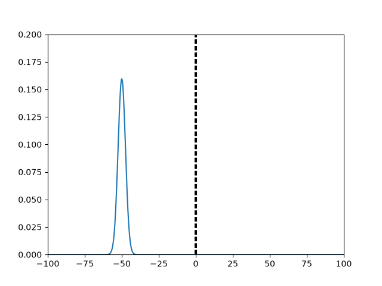

# wavepacket-tunneling

Quantum tunnelling: a wave packet hits a potential barrier that it classically cannot get over, and a small part of it gets through anyway.

## Why

To show what QM allows that is classically forbidden.

## The physics

Tunnelling needs three things:

- E < V0, so the barrier is classically forbidden.
- V0 finite. Inside the barrier the wavefunction decays like e^(-kappa*x), with kappa = sqrt(2(V0 - E)) (hbar = m = 1). The higher V0 is, the faster it decays.
- The barrier not too wide. The wave has to still be there when it reaches the other side, so the transmission T falls roughly like e^(-2*kappa*L) for a barrier of width L.

Here the packet starts at x = -50 moving right (k0 = 3, so E is about 4.5) towards a barrier of height V0 = 20 and width 1 at the centre. E/V0 is about 0.23.

## How it works

The Hamiltonian is built as a matrix, the same way as in my schrodinger-solver repo: the second derivative becomes a matrix on a grid, and the potential goes on the diagonal.

The wave packet is then stepped forward in time with the Crank-Nicolson method:

    (I + i*dt*H/2) psi_new = (I - i*dt*H/2) psi_old

This keeps the total probability at 1, which a simpler time step would not.

At the end, R and T come from integrating |psi|^2 on each side of the barrier: R is the probability on the left (reflected) and T on the right (transmitted).

Grid: x from -100 to 100 with N = 1000 points, dt = 0.005, run to t = 40.

## Results

- The wave packet partly reflects, and a tiny part tunnels through.
- R = 0.99999 and T = 9.5e-6, about 1 in 100,000.
- R + T = 1 to 12 decimal places, so probability is conserved.
- The transmitted part is far too small to see on the GIF. The log scale plot shows the tail on the far side of the barrier.

## Known limitations

- T comes out lower than the analytic value. For this barrier and packet the analytic transmission is 4.3e-5, against 9.5e-6 from the code. With a grid spacing of 0.2, the barrier |x| < 0.5 covers 6 grid points, so on the grid it is about 1.2 wide instead of 1.0, and tunnelling drops off fast with width. Making the grid finer fixes it:

| Grid spacing | Points in barrier | T |
|---|---|---|
| 0.2 (as in the code) | 6 | 9.5e-6 |
| 0.1 | 10 | 5.1e-5 |
| 0.05 | 20 | 4.5e-5 |
| analytic | | 4.3e-5 |

- It is slow, about 30 minutes for a full run. Every time step solves the same matrix equation again from scratch. Solving it once at the start would give the same result in seconds.
- Running it overwrites tunnelling.gif.

## Running it

Needs Python with numpy and matplotlib:

    pip install numpy matplotlib
    python wavepacket_tunneling.py

It shows the starting packet, a free packet, the packet hitting the barrier and the log scale tail, prints R and T, then saves the GIF. Close each plot to move on.
